<div align="center">

# ChemLarp

**A free, open-source chemistry workbench: draw a molecule, then name it, see it in 3D, run quantum chemistry and molecular dynamics, simulate reactions, mixtures, proteins and whole chemical plants, all in one program.**

[**Open ChemLarp in your browser →**](https://ayuroy01.github.io/ChemLarp/) &nbsp;·&nbsp; [**Install it (step-by-step guide)**](INSTALL.md) &nbsp;·&nbsp; [What it can do](#what-it-can-do) &nbsp;·&nbsp; [How accurate is it?](#how-accurate-is-it)

[](https://github.com/ayuroy01/ChemLarp/actions/workflows/ci.yml)
[](https://ayuroy01.github.io/ChemLarp/)
[](LICENSE)
-informational)

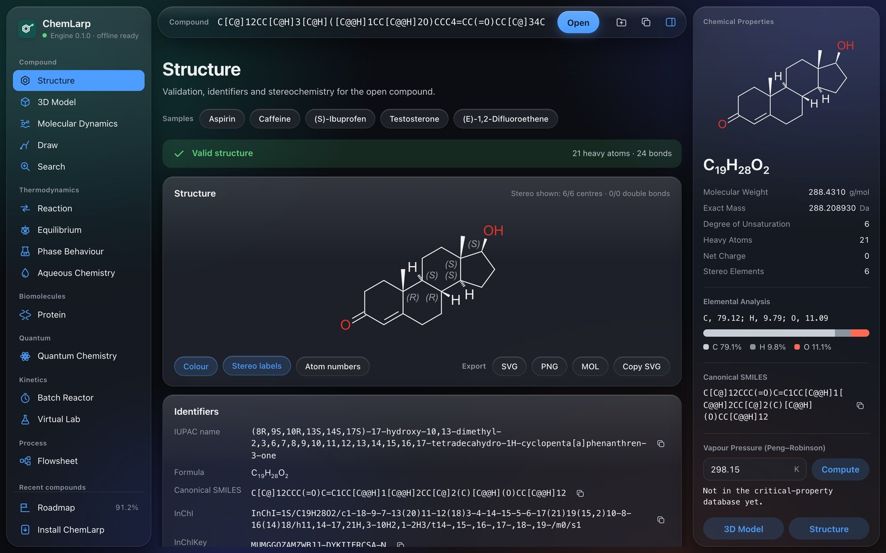

<sub>Testosterone typed as a SMILES string: ChemLarp works out all six stereocentres, writes the full IUPAC name, the InChI and InChIKey, and the properties on the right. Nothing is looked up online.</sub>

</div>

---

## What is ChemLarp?

ChemLarp is one program that does the jobs chemists usually need several separate, often expensive tools for:
drawing and naming structures, 3D models, quantum chemistry, force fields and molecular dynamics, reaction
thermodynamics and equilibrium, combustion kinetics, phase equilibrium, water chemistry, protein preparation,
process flowsheets and a virtual lab with safety checks.

- **No installation needed.** The whole engine runs inside your web browser. Nothing is uploaded: every calculation happens on your own computer or phone, and it keeps working offline after the first visit.
- **Free and open source** under the Apache 2.0 licence, for students, teachers, researchers and companies alike. No licence server, no account, no subscription.
- **Written from scratch.** Every part, from the SMILES reader to the DFT code and the stiff ODE solver, is ChemLarp's own C++20 code, with no third-party libraries. The same engine runs in the browser (WebAssembly), as a desktop and phone app, on the command line, and from Python, C and JavaScript.
- **Checked against the reference tools.** Results are compared with established programs and published data (RDKit, PySCF, PHREEQC, OPSIN, PubChem, the official MMFF94 suite, NIST/JANAF). The numbers are [below](#how-accurate-is-it), and every known shortfall is listed openly in [docs/GAPS.md](docs/GAPS.md).

<div align="center">
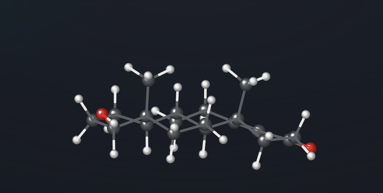
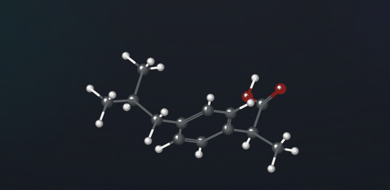
<br>
<sub>Left: a 3D model built from the SMILES by distance geometry and a force field, keeping every stereocentre. Right: ibuprofen moving at 300 K, simulated with MMFF94 in the browser.</sub>
</div>

---

## What it can do

### Molecules: drawing, names, identifiers, 3D

Draw a structure or type it as SMILES, or open MOL/SDF, PDB and CML files. ChemLarp checks valence as you draw,
reads stereochemistry from wedges, and gives systematic **IUPAC names**, **InChI/InChIKey**, canonical SMILES and
**R/S, E/Z** by the full CIP rules (axial and planar chirality included). **SMARTS substructure search** and
fingerprint **similarity** work across whole SD files. **3D models** are built with UFF, MMFF94 or MMFF94s, and the
stereochemistry is checked in 3D.

<p align="center">
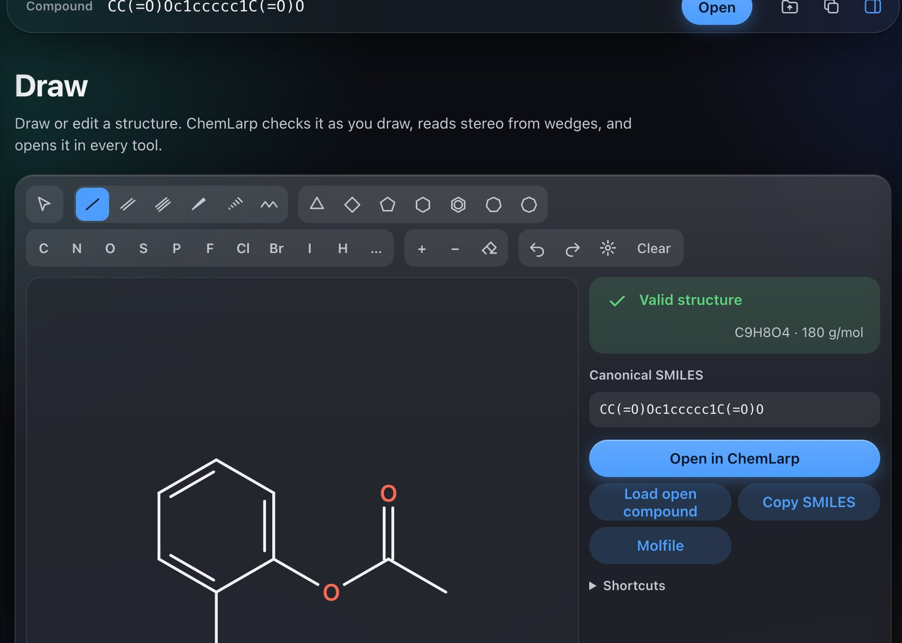
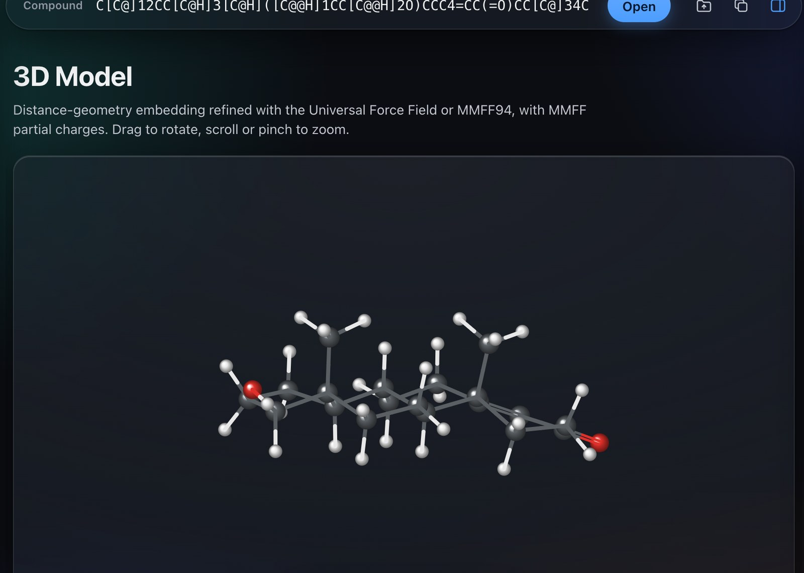
</p>

### Quantum chemistry and molecular dynamics

**Hartree–Fock and DFT** (SVWN, PBE, B3LYP) with STO-3G to 6-31G* basis sets: energy, HOMO/LUMO, orbital
energies, Mulliken charges, dipole. Left: B3LYP/6-31G* on p-benzoquinone, 128 basis functions, run in the
browser. **Molecular dynamics** with MMFF94 or UFF at constant energy or temperature, with energy and temperature
traces, vibrational spectrum, normal modes and an animated trajectory.

<p align="center">
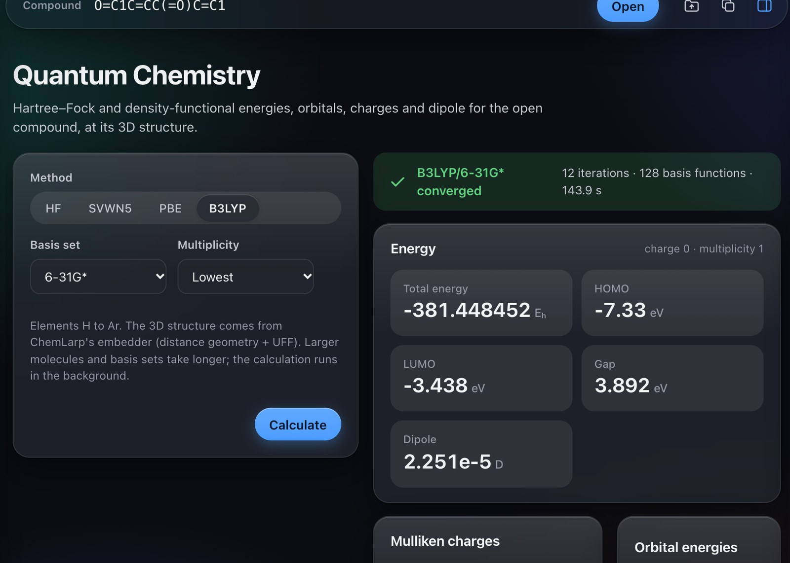
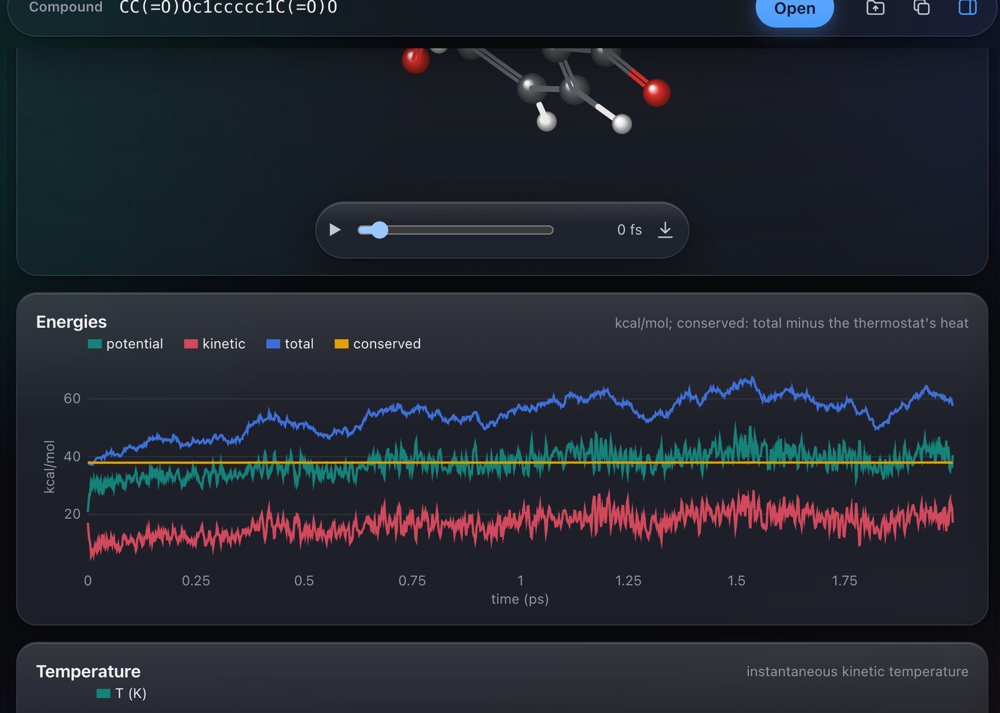
</p>

### Proteins and reactions

**Protein preparation** from a PDB ID or file: missing side chains and loops rebuilt, the pKa of every
titratable group predicted from the structure, protonation states set for your pH, all hydrogens placed with the
hydrogen-bond network optimised (left: ubiquitin, 629 hydrogens in 24 ms). **Chemical kinetics** with stiff
mechanisms in CHEMKIN, Cantera YAML or ChemLarp's own format (right: hydrogen–oxygen ignition at 1000 K), plus
reaction thermodynamics (ΔH°, ΔS°, ΔG°, K) and **Gibbs-minimisation equilibrium**.

<p align="center">
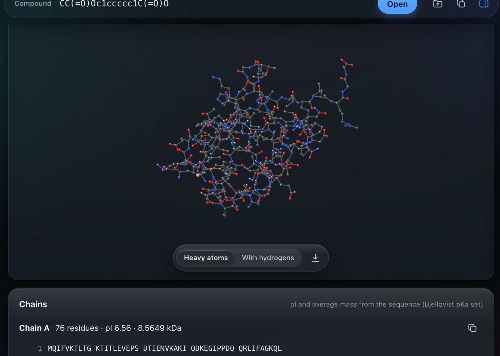
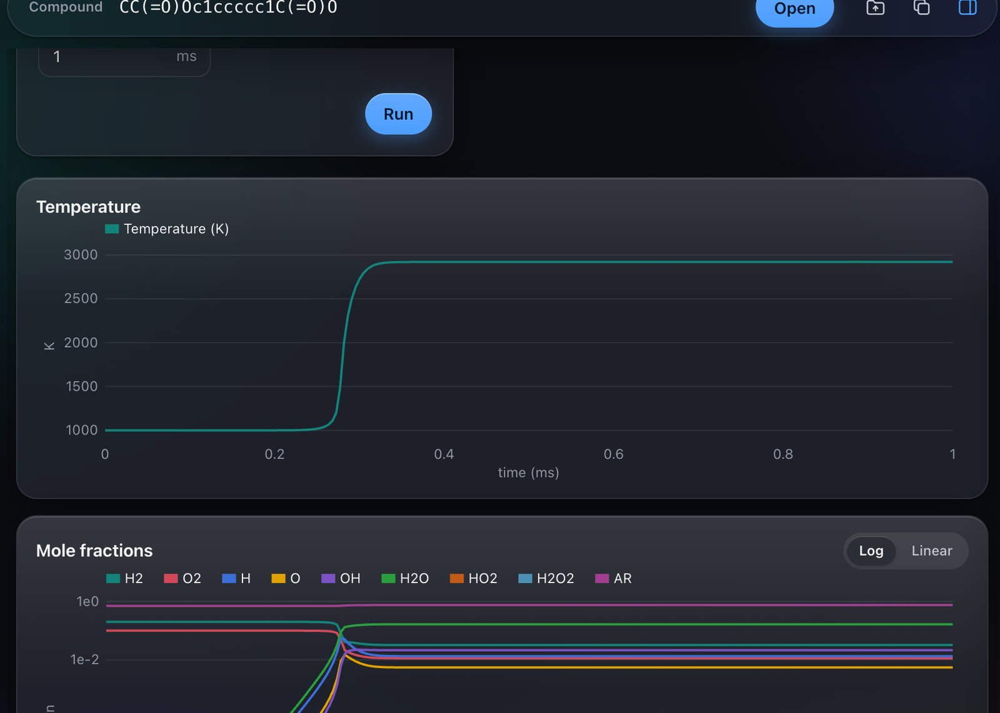
</p>

### Mixtures, water chemistry and process simulation

**Phase behaviour**: vapour–liquid flash with Peng–Robinson or SRK, and bubble and dew points with UNIFAC or
NRTL, over a database of 365 pure compounds. **Water chemistry**: pH, speciation, saturation indices and
minerals and gases from 0 to 100 °C, with the USGS PHREEQC database. **Process flowsheets**: mixers, heaters,
flash drums, splitters, reactors and rigorous distillation columns joined by streams, with recycle loops.

<p align="center">
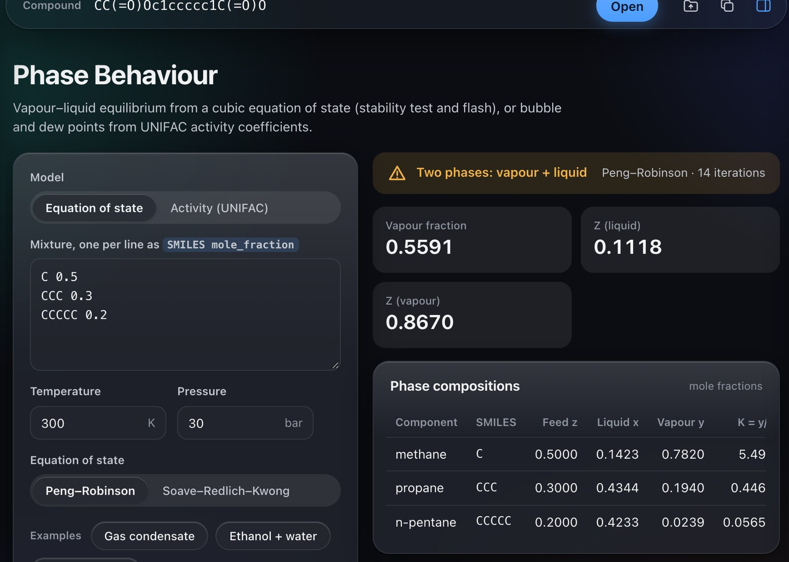
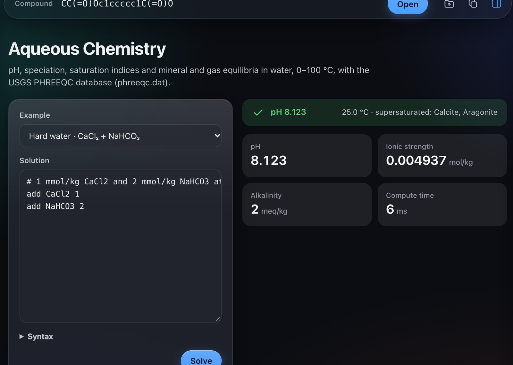
</p>
<p align="center">
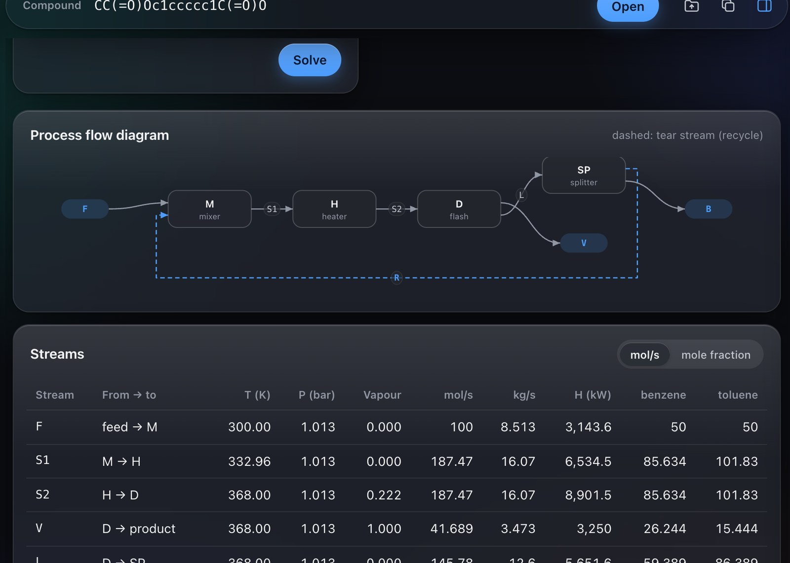
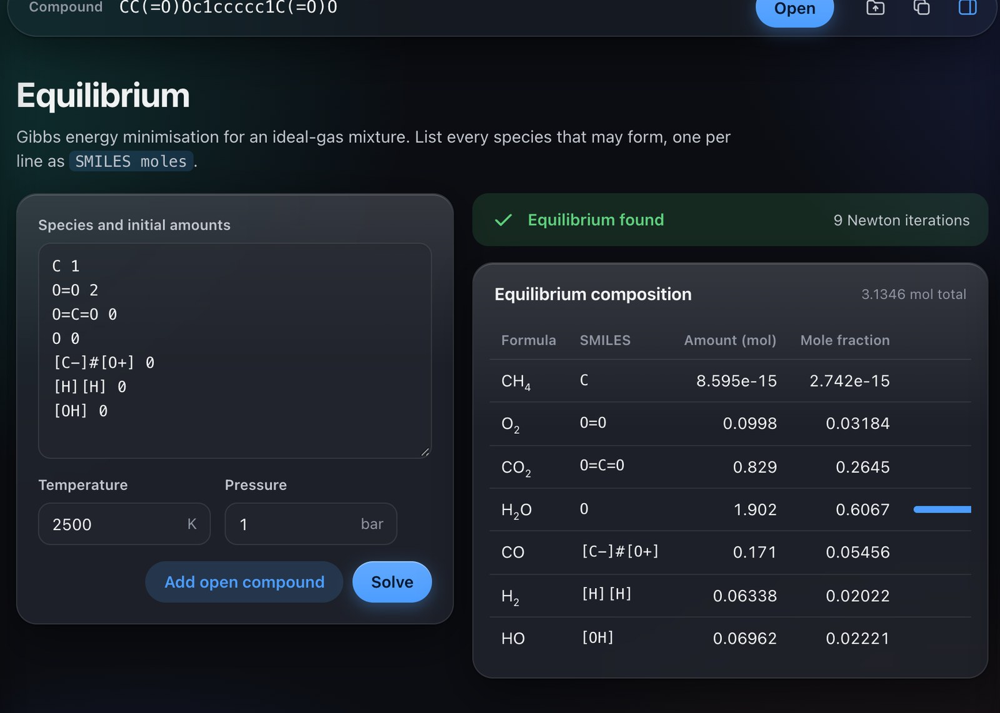
</p>

### Virtual lab with safety checks

Mix solutions or run a titration before doing it for real. ChemLarp predicts pH, heat released, temperature
change, precipitates and gases. It also flags dangerous combinations, with the source cited: incompatibility rules
from the US National Research Council's *Prudent Practices in the Laboratory*, and GHS hazard classifications from
PubChem for 207 laboratory chemicals. Below: bleach with ammonia, and phosphoric acid titrated with sodium
hydroxide. These are teaching aids, not a risk assessment.

<p align="center">
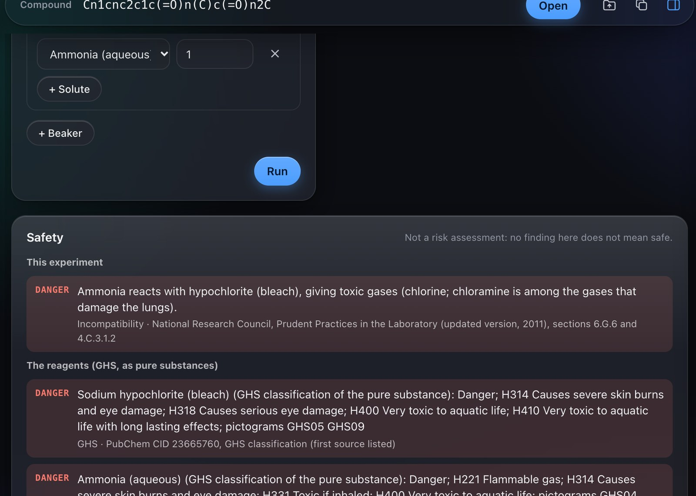
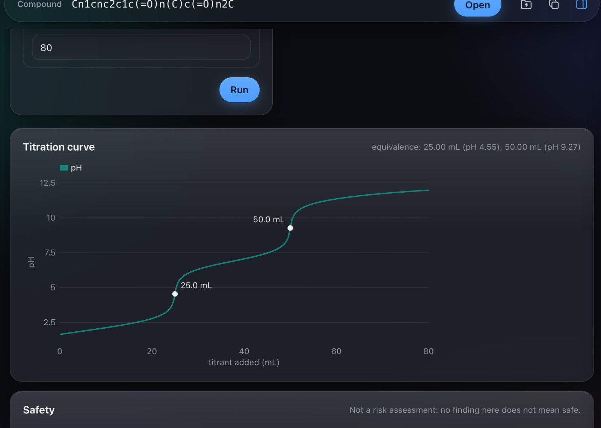
</p>

### On your phone too

<div align="center">
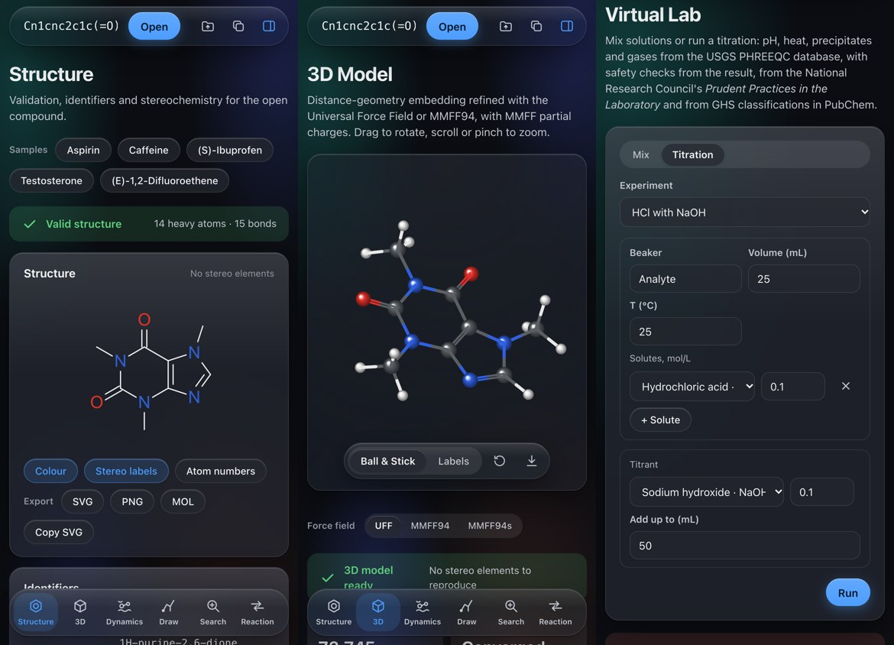
</div>

---

## Why ChemLarp is different

| You usually need… | Typical tools | In ChemLarp |
|---|---|---|
| Structure drawing, naming, identifiers | ChemDraw, ACD/Name, MarvinSketch | Editor, IUPAC names, InChI, CIP R/S and E/Z, SMARTS search |
| Quantum chemistry | Gaussian, ORCA, PySCF | HF and DFT single points, in the browser |
| Force fields and molecular dynamics | Schrödinger, OpenMM, RDKit | MMFF94/94s, UFF, NVE/NVT dynamics, normal modes |
| Protein preparation | Schrödinger Protein Preparation, PDB2PQR, PROPKA | Repair, pKa, protonation and hydrogen placement |
| Combustion kinetics and equilibrium | Cantera, CHEMKIN | Stiff kinetics, CHEMKIN/YAML import, Gibbs minimisation |
| Process simulation | Aspen Plus, HYSYS, DWSIM | Flash, unit operations, flowsheets with recycle, distillation |
| Aqueous chemistry | PHREEQC, Visual MINTEQ | Speciation, saturation, minerals and gases |
| Virtual laboratory | Labster and similar | Mixing, titration, calorimetry, safety rules |

**Honest positioning.** Commercial packages are larger and more mature in each of these areas, and ChemLarp does
not replace them for production work at scale: its quantum chemistry stops at 6-31G* single points, its process
models cover common unit operations, and its explicit-water engine is slow. What it offers is breadth in one
place, at no cost, on any device, with source code you can read and change. Each tool also tells you what it does
not cover ([docs/GAPS.md](docs/GAPS.md)). It suits teaching, learning, quick checks, and anyone without access to
expensive licences.

---

## How accurate is it?

Building these from scratch and getting them to agree with established programs was the hard part. Some of the checks:

| What | Compared with | Result |
|---|---|---|
| MMFF94 force field | Merck's official MMFF94 validation suite (761 molecules) | 17,231 of 17,231 atom types identical; 752 of 759 energies within 0.0001 kcal/mol |
| Hartree–Fock and DFT | PySCF on the same geometries | HF within 2×10⁻⁷ hartree (19 molecules × 4 basis sets); DFT within 2×10⁻⁶ |
| IUPAC names | OPSIN (independent name-to-structure parser) | 14,188 of 14,193 names parse back to exactly the input structure, stereochemistry included |
| InChI | PubChem | 1,483 of 1,500 identical on a random sample never used for tuning |
| CIP R/S labels | RDKit's CIP labeller | 816 of 816 PubChem stereo structures |
| SMARTS substructure search | RDKit | 187,338 of 187,375 pattern–molecule pairs identical (99.98 %) |
| Structure files | RDKit reading the same files | 999 of 999 PubChem 2D, 865 of 866 PubChem 3D |
| Thermochemistry | JANAF tables | within 0.6 kJ/mol |
| Water chemistry and virtual lab | PHREEQC on the same solutions | pH within 0.002; precipitates and gases within 0.3 % |
| Vapour pressures | NIST | 0.1–0.7 % for non-polar compounds |
| Protein hydrogens | Deposited NMR structures | 0.06–0.14 Å RMS |
| Free-energy estimators | pymbar | within 5×10⁻¹⁰ kT |

Details, methods and every exception are in [docs/ARCHITECTURE.md](docs/ARCHITECTURE.md). The validation scripts
are in [`scripts/`](scripts) and run with one command (`make validate`). The C++ test suite (more than 230 tests) runs on
Windows, macOS and Linux for every change.

---

## Get it

**Easiest: no installation.** Open **https://ayuroy01.github.io/ChemLarp/** in Chrome, Edge, Safari or Firefox.
To keep it as an app, use **Install app** (Chrome/Edge) or **Share → Add to Home Screen** (iPhone/iPad).

**Never installed software from GitHub before?** Follow the plain-language, step-by-step
[**installation guide**](INSTALL.md). It covers Windows, Mac, Android, iPhone, and Python for people who want to
write scripts.

| Platform | What to download | Guide |
|---|---|---|
| Any device | Nothing: use the web app | [INSTALL.md § Browser](INSTALL.md#option-1-use-it-in-your-web-browser-no-installation) |
| Windows 10/11 | `ChemLarp-…-windows-x64-setup.exe` | [INSTALL.md § Windows](INSTALL.md#windows) |
| macOS 12+ (Apple silicon and Intel) | `ChemLarp-…-macos.dmg` | [INSTALL.md § Mac](INSTALL.md#mac) |
| Android 8+ | `ChemLarp-…-android.apk` | [INSTALL.md § Android](INSTALL.md#android) |
| Python 3.10+ | `chemlarp-…whl` | [INSTALL.md § Python](INSTALL.md#option-3-python-for-scripts-and-notebooks) |

Downloads are on the [Releases page](https://github.com/ayuroy01/ChemLarp/releases/latest).

---

## For developers

The engine is a C++20 library with a C ABI, a command-line program, Python bindings (ctypes) and a WebAssembly
build. The only requirement is a C++20 compiler; there are no other dependencies.

```bash
git clone https://github.com/ayuroy01/ChemLarp.git
cd ChemLarp
make -j8                 # or: scripts/build.sh (CMake if installed); Windows: scripts\build.ps1
./build/chemlarp_tests   # the test suite
```

<details>
<summary><b>Command-line examples</b></summary>

```bash
./build/chemlarp name 'CC(C)Cc1ccc(cc1)[C@H](C)C(=O)O'    # (2S)-2-[4-(2-methylpropyl)phenyl]propanoic acid
./build/chemlarp inchi 'C[C@@H](C(=O)O)N'                   # InChI and InChIKey
./build/chemlarp qc 'C=O' --method b3lyp --basis 6-31G*     # HF / DFT energy, orbitals, charges, dipole
./build/chemlarp embed 'C[C@@H](C(=O)O)N' --sdf alanine.sdf # 3D structure with stereo checked
./build/chemlarp depict 'C[C@@H](C(=O)O)N' -o alanine.svg --cip
./build/chemlarp reaction '1 C + 2 O=O -> 1 O=C=O + 2 O' -T 298.15
./build/chemlarp equilibrate -T 2500 C 1 O=O 2 O=C=O 0 O 0 '[C-]#[O+]' 0
./build/chemlarp kinetics data/mechanisms/h2o2.ocm -m adiabatic-v -T 1000 -P 1 -t 1e-3 H2=2 O2=1 AR=7
./build/chemlarp protein 1crn.pdb --pH 7.4
./build/chemlarp                                             # lists every command
```

Quote SMILES with single quotes in bash, zsh and PowerShell, and double quotes in `cmd.exe`.
</details>

<details>
<summary><b>Python examples</b></summary>

```python
import chemlarp
chemlarp.iupac_name("CC(=O)Oc1ccccc1C(=O)O")         # '2-(acetyloxy)benzoic acid'
chemlarp.inchi("N[C@@H](C)C(=O)O")["key"]            # 'QNAYBMKLOCPYGJ-REOHCLBHSA-N'
chemlarp.qc("O", "b3lyp", "6-31G*")["energy"]        # hartree
chemlarp.embed("N[C@@H](C)C(=O)O")["sdf"]            # 3D molfile
chemlarp.equilibrate({"[C-]#[O+]": 1, "O": 1, "O=C=O": 0, "[H][H]": 0}, temperature_K=1000)
chemlarp.kinetics("data/mechanisms/h2o2.ocm", {"H2": 2, "O2": 1, "AR": 7}, 1000, 1e5, t_end=1e-3)["ignition_time"]
chemlarp.protein("1crn.pdb", pH=7.4)
```
</details>

| Document | What is in it |
|---|---|
| [INSTALL.md](INSTALL.md) | Beginner installation guide |
| [docs/ARCHITECTURE.md](docs/ARCHITECTURE.md) | Every module, what is built, how it was validated |
| [docs/GAPS.md](docs/GAPS.md) | Everything that is not finished, and how to pick it up |
| [docs/MATH.md](docs/MATH.md) | The mathematics from SMILES to Gibbs equilibrium |
| [docs/PACKAGING.md](docs/PACKAGING.md) | How the apps and packages are built and released |
| [Roadmap](https://ayuroy01.github.io/ChemLarp/#roadmap) | Progress by module, live in the web app |

## Contributing

Bug reports, chemistry corrections and test cases are welcome: open an
[issue](https://github.com/ayuroy01/ChemLarp/issues). When a result looks wrong, please include the input (a SMILES
string or file) and what you expected, with a reference if you have one.

## License

Apache License 2.0; see [LICENSE](LICENSE). Free for personal, academic and commercial use.
